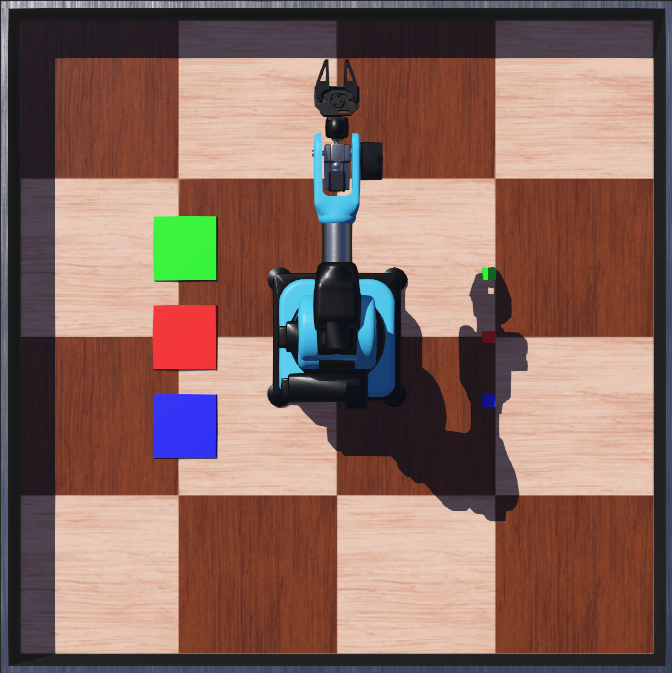
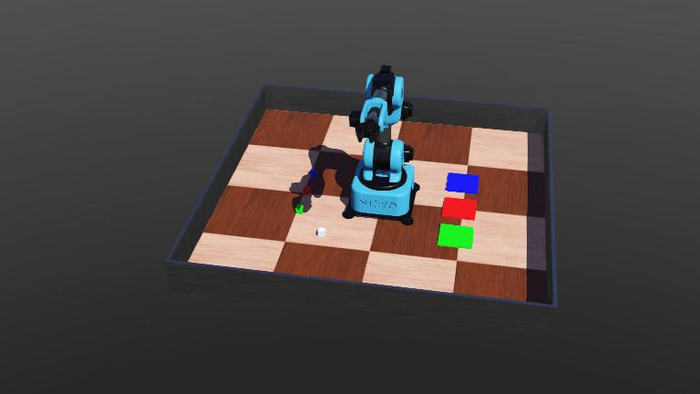

# Simulasi Pick and Place dengan Robot Niryo Ned pada Webots Simulator
Repository penugasan mata kuliah Pemodelan Robotika untuk materi Pick and Place

<!-- <video src="media/demo.mp4" controls width="640" height="360">
  Your browser does not support the video tag.
</video> -->



Repository ini berisi implementasi simulasi sistem **Pick and Place** menggunakan robot manipulator 6-DOF **Niryo Ned** pada simulator **Webots R2025a** dengan pemodelan kinematika mandiri berbasis *Standard Denavit-Hartenberg (DH)* dan *Inverse Kinematics* numerik.

## Identitas Kelompok

- Afdal Luthfi (26/589503/SPA/01243)
- Rafael Andika Radya Hadi Kusuma (26/591157/PPA/07434)

## Deskripsi Singkat



Program terdiri dari berkas dunia simulasi Webots (`niryo-ned-pnp.wbt`) dan dua controller berbasis Python yang sama-sama menggunakan modul kinematika mandiri (`ik_solver.py`):

1. **Controller Otomatis (`niryo_ned_pnp`)**: Menjalankan urutan *Pick and Place* secara otomatis menggunakan *Finite State Machine* (FSM) dan API `Supervisor` Webots untuk memindahkan kotak berwarna (hijau, merah, dan biru) ke area warna masing-masing sekaligus memverifikasi hasil pengangkatan dan peletakan.
2. **Controller Interaktif GUI (`ik_test`)**: Menyediakan antarmuka desktop berbasis **Tkinter** untuk menggerakkan sendi robot secara manual menggunakan *Forward Kinematics* (slider sudut joint), merekam daftar *waypoint* ke berkas JSON, dan memutarnya kembali (*replay*) menggunakan solver *Inverse Kinematics*.

Modul kinematika (`NiryoNedIK`) mengimplementasikan *Forward Kinematics* berbasis *Standard DH* yang terkalibrasi terhadap geometri `Ned.proto` hingga titik tengah celah gripper (TCP), *Geometric Position Jacobian* ($3\times 6$), indeks manipulabilitas Yoshikawa ($w = \sqrt{\det(J J^T)}$), konstrain orientasi gripper vertikal (`keep_vertical=True`), serta dua metode penyelesaian IK numerik *multi-seed*: **Moore-Penrose Pseudo-Inverse Jacobian (`jacobian`)** dan **Damped Least Squares (`dls`)**.

## Struktur Utama

```text
worlds/
  niryo-ned-pnp.wbt                   Dunia simulasi Webots R2025a (Niryo Ned, kotak & area warna)
controllers/
  niryo_ned_pnp/
    niryo_ned_pnp.py                  Controller otomatis Pick and Place (FSM + verifikasi Supervisor)
    ik_solver.py                      Modul FK (Standard DH), Jacobian, Manipulabilitas & IK (Jacobian/DLS)
  ik_test/
    ik_test.py                        Controller interaktif GUI Tkinter (rekam FK slider & replay IK)
    ik_solver.py                      Modul solver FK/IK untuk controller ik_test
```

## Instalasi

Simulasi ini dikembangkan dan diuji menggunakan **Webots R2025a** dan **Python 3** pada sistem operasi Windows.

```powershell
git clone https://github.com/therafaeliger/ppr-pick-n-place.git
cd ppr-pick-n-place
python -m venv .venv
.venv\Scripts\Activate.ps1
python -m pip install numpy
```

Pastikan pada pengaturan Webots (**Tools -> Preferences -> General -> Python command**) diarahkan ke interpreter Python yang sudah memiliki pustaka `numpy` (dan `tkinter` bawaan Python untuk menjalankan controller `ik_test`).

## Cara Menjalankan: Simulasi Otomatis (`niryo_ned_pnp`)

1. Buka aplikasi **Webots R2025a**, lalu buka berkas dunia simulasi `worlds/niryo-ned-pnp.wbt`.
2. Pastikan node `Ned` pada Scene Tree menggunakan controller `"niryo_ned_pnp"` dengan `supervisor` bernilai `TRUE` (sudah menjadi konfigurasi bawaan pada berkas `.wbt`).
3. Klik tombol **Play** untuk memulai simulasi. Robot akan mengeksekusi tugas pada daftar `TASKS` secara berurutan (Hijau $\rightarrow$ Merah $\rightarrow$ Biru) mengikuti alur FSM:
   `PRE_PICK -> PICK -> GRASP -> LIFT -> TRANSIT -> PRE_PLACE -> PLACE -> RELEASE -> RETRACT`
   lalu kembali ke posisi `HOME` (`[0, 0, 0, 0, 0, 0]`).
4. Pantau konsol Webots untuk melihat log setiap *waypoint* (target koordinat, status konvergensi IK, jumlah iterasi, galat posisi dalam mm, indeks manipulabilitas Yoshikawa), verifikasi fisik `[CEK ANGKAT]` dan `[CEK TARUH]`, serta ringkasan performa IK di akhir siklus.
5. Untuk mengganti metode IK, ubah variabel `METHOD` pada `controllers/niryo_ned_pnp/niryo_ned_pnp.py` menjadi `"jacobian"` atau `"dls"` (atau atur variabel lingkungan `IK_METHOD`).
6. Untuk menambah kasus *Pick and Place* baru, tambahkan entri baru pada daftar `TASKS` (atau aktifkan entri `WHITE_BOX` yang sudah tersedia pada kode).

### Catatan Tambahan
* Metode IK bawaan pada `niryo_ned_pnp.py` adalah `"jacobian"` (Moore-Penrose Pseudo-Inverse) dengan toleransi konvergensi `IK_TOLERANCE = 5e-4 m` (0,5 mm) dan opsi pembanding `"dls"` (damping adaptif `0.045` / `0.020`).
* Ketinggian ambil `pick` diset pada `z = 0.019 m` dan letak `place` pada `z = 0.024 m`, dengan tinggi angkat aman `Z_OFFSET = 0.10 m` serta titik transit aman `SAFE_WAYPOINT = [0.0, 0.22, 0.15]`.
* Konstrain orientasi vertikal (`keep_vertical=True`) menjaga gripper selalu tegak lurus menghadap ke bawah dengan $q_4 = 0$, $q_6 = 0$, dan $q_5 = q_2 + q_3 - \pi/2$.
* Verifikasi `Supervisor` memeriksa kenaikan kotak minimal `40 mm` pada fase `LIFT` dan galat posisi XY maksimal `30 mm` terhadap titik area pada fase `RETRACT`.
* Variabel lingkungan opsional `WEBOTS_AUTO_QUIT=1` dapat digunakan untuk menutup simulasi secara otomatis setelah seluruh tugas selesai atau berhenti karena galat.

## Cara Menjalankan: Mode Interaktif GUI (`ik_test`) & Konfigurasi World

Selain mode otomatis, repository ini menyediakan controller `ik_test` berbasis Tkinter untuk menguji *Forward Kinematics* dan *Inverse Kinematics* secara interaktif langsung di Webots.

### Konfigurasi Objek pada World (`worlds/niryo-ned-pnp.wbt`)

| DEF / Node | Nama | Posisi World `(X, Y, Z)` m | Dimensi / Keterangan |
| ---------- | ---- | -------------------------- | -------------------- |
| `Ned` | Robot Niryo Ned | `(0.00, 0.00, 0.00)` | 6-DOF, `controller "niryo_ned_pnp"`, `supervisor TRUE` |
| `GREEN_BOX` | `green_box` | `(0.24, 0.10, 0.01)` | Kotak `0.02 × 0.02 × 0.02 m`, massa `0.001 kg` |
| `RED_BOX` | `red_box` | `(0.24, 0.00, 0.01)` | Kotak `0.02 × 0.02 × 0.02 m`, massa `0.001 kg` |
| `BLUE_BOX` | `blue_box` | `(0.24, -0.10, 0.01)` | Kotak `0.02 × 0.02 × 0.02 m`, massa `0.001 kg` |
| `WHITE_BOX` | `white_box` | `(0.15, 0.20, 0.01)` | Kotak tambahan `0.02 × 0.02 × 0.02 m`, massa `0.001 kg` |
| `GREEN_AREA` | `green_area` | `(-0.24, 0.14, 0.0025)` | Area target `0.10 × 0.10 × 0.005 m` |
| `RED_AREA` | `red_area` | `(-0.24, 0.00, 0.0025)` | Area target `0.10 × 0.10 × 0.005 m` |
| `BLUE_AREA` | `blue_area` | `(-0.24, -0.14, 0.0025)` | Area target `0.10 × 0.10 × 0.005 m` |

### Langkah Menggunakan Mode GUI (`ik_test`)

1. Buka `worlds/niryo-ned-pnp.wbt` di Webots, lalu ubah properti `controller` pada node `Ned` dari `"niryo_ned_pnp"` menjadi `"ik_test"`, kemudian simpan dan mulai simulasi.
2. Jendela **Niryo Ned - Pick & Place (FK Rekam, IK Jacobian Replay)** akan muncul secara otomatis.
3. Pada bagian **1. MODE FK**, geser slider sudut $\theta_1$ hingga $\theta_6$ (rentang otomatis mengikuti *joint limits* `Ned.proto`) untuk mengarahkan ujung gripper, sambil memantau koordinat `XYZ aktual (DH)` di bagian bawah jendela.
4. Pada bagian **2. Gripper & Rekam Titik**, pilih kondisi **Gripper BUKA** atau **Gripper TUTUP**, lalu klik **SIMPAN TITIK** untuk menambah pose ke daftar *waypoint*.
5. Pada bagian **3. Sekuens Titik**, kelola daftar *waypoint* (**Hapus terpilih**, **Kosongkan**) serta simpan atau muat sekuens ke berkas `controllers/ik_test/sekuens_ned.json` (**Simpan JSON** / **Muat JSON**).
6. Pada bagian **4. REPLAY dengan IK**, pilih metode IK (**Jacobian** atau **DLS**), aktifkan **Ulangi terus** jika diinginkan, lalu klik **▶ REPLAY**. Gunakan **■ STOP** untuk menghentikan replay atau **HOME** untuk mengembalikan robot ke sudut nol.

### Format Sekuens JSON (`sekuens_ned.json`) & Metrik Konsol

Setiap titik yang disimpan dari mode GUI dicatat dalam format JSON dengan koordinat TCP hasil FK (meter) dan status gripper:

```json
[
  {
    "nama": "P1",
    "xyz": [0.24, 0.1, 0.119],
    "gripper_tertutup": false
  }
]
```

Saat *replay* dijalankan, solver mencoba penyelesaian dengan orientasi vertikal (`keep_vertical=True`) terlebih dahulu dan secara otomatis beralih ke 6-DOF bebas (`keep_vertical=False`) jika *waypoint* tidak dapat dicapai secara vertikal, sambil menampilkan jumlah iterasi, galat posisi (mm), dan nilai manipulabilitas minimum pada panel GUI maupun konsol Webots.
